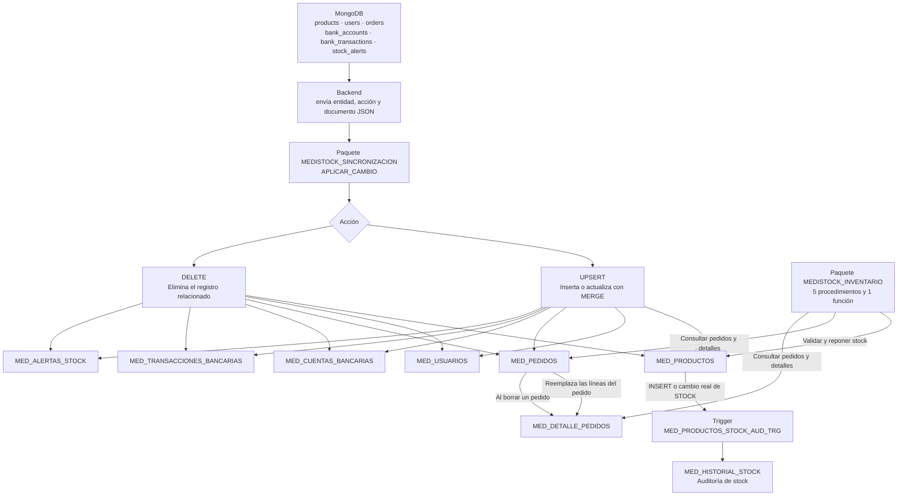

# Resumen del esquema Oracle de MediStock

El script `oracle-schema.sql` define una réplica relacional de datos de MongoDB y ejemplos de lógica de inventario en PL/SQL.

## Diagrama del flujo

## Objetos implementados

| Tipo | Cantidad | Detalle |
|---|---:|---|
| Tablas | 8 | Productos, usuarios, pedidos, detalle de pedidos, cuentas bancarias, transacciones bancarias, alertas de stock e historial de stock |
| Paquetes PL/SQL | 2 | `MEDISTOCK_SINCRONIZACION` y `MEDISTOCK_INVENTARIO` |
| Procedimientos | 6 | 1 de sincronización y 5 de inventario |
| Funciones | 1 | Cálculo del valor total del inventario |
| Triggers | 1 | Auditoría de inserciones de productos y cambios reales en el stock |
| Índices explícitos | 3 | Búsqueda de pedidos por cliente/fecha, transacciones por cuenta/fecha e historial por producto/fecha |
| Colecciones PL/SQL | 1 | Un `VARRAY` para reponer productos en lote, con máximo de 100 IDs |

### Procedimientos

- `APLICAR_CAMBIO`: inserta/actualiza o elimina datos replicados desde MongoDB.
- `VALIDAR_STOCK_PEDIDO`: comprueba que el producto exista y tenga stock suficiente.
- `REPONER_PRODUCTO`: repone un producto individual.
- `REPONER_PRODUCTOS`: repone varios productos como una operación de lote; revierte el lote si ocurre un error.
- `LISTAR_STOCK_BAJO`: lista productos en o por debajo del stock mínimo, con filtro opcional por categoría.
- `MOSTRAR_PEDIDOS`: presenta pedidos y sus líneas mediante cursores anidados.

### Función y trigger

- `CALCULAR_VALOR_TOTAL`: suma `PRECIO * STOCK` para obtener el valor del inventario.
- `MED_PRODUCTOS_STOCK_AUD_TRG`: registra el stock inicial al insertar un producto y los valores anterior/nuevo cuando cambia el stock. No registra actualizaciones que no modifiquen el stock.

**En resumen:** el SQL define **1 trigger, no 4**, y **6 procedimientos** distribuidos en **2 paquetes**.
